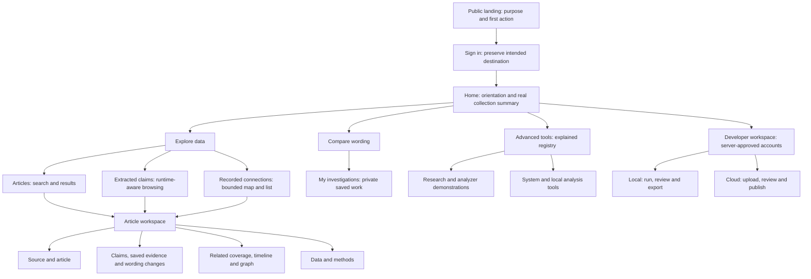

# GMEE navigation and data experience architecture

Date: 2026-10-16, Asia/Calcutta. Status: **design and implementation handoff;
not implemented by this document**. Owner: Codex coordinates architecture and
integration; the assigned Antigravity environment implements the scoped change.

Read with [current project structure](PROJECT_STRUCTURE.md),
[contributor rules](../CONTRIBUTING.md), [cloud publishing](CLOUD_PUBLISHING.md)
and the [master task sheet](../TASK_SHEET.md). This plan supersedes navigation
choices in [reader clarity](READER_CLARITY_PLAN.md) for this next iteration;
its preservation and scientific interpretation rules remain in force.

Copyable implementation instructions:
[Antigravity handoff prompt](prompts/ANTIGRAVITY_NAVIGATION_HANDOFF.md).

## 1. Product purpose and measurable outcome

Use this product statement consistently:

> GMEE helps people explore collected news articles, inspect statements extracted
> from them, and compare how reporting is worded, with sources and analysis context.

The first screen must answer **what this is, what data exists, what I can do,
and where to begin**. Users should not need to know database names or model
terminology before finding a report. Advanced users must retain every existing
tool. A smaller interface must not silently become a smaller product.

Success is observable, rather than a claim that the design is “perfect”:

- An uncoached visitor explains the purpose in their own words after 30 seconds.
- A signed-in user finds a source article and its statements within two minutes.
- Advanced tools is visible immediately in the workspace navigation; a specific
  tool is reachable in at most two navigation actions after sign-in.
- Every article detail tab remains accessible. Back restores the search state.
- Users can distinguish extracted statements, saved assessments and original sources.
- Ordinary navigation runs no collection, inference, publication or label submission.
- Missing data, unavailable capabilities and failed requests look different.

## 2. Facts the implementation must respect

The verified source baseline is `df6940c323335e641e1a3526c65df77f3eced308`
on `codex/project-foundation`, PR #6. At preparation time that PR is open;
do not assume another environment's `main` includes its new source locations.
Inspect current Git state before starting and integrate later main changes deliberately.

GMEE has two runtime compositions, not two unrelated products:

| Concern | Published workspace | Local analysis workspace |
| --- | --- | --- |
| Articles | Published source metadata and original links | Locally collected records and stored text where present |
| Extracted claims | Previously saved statements/assessments | Stored claims within article detail; local checking also available |
| Search | Literal title/author matching; published claim text search | Article title/author search plus separate semantic retrieval capability |
| Connections | Saved, bounded relationship projections | Stored relational/Neo4j capabilities where configured |
| New AI work | Not executed | Available only through existing explicit, authorized actions |
| Developer workflow | Upload -> review -> publish | Collect -> process -> review -> export; local upload may be staging-only |

The observed active release contains 7,421 articles, 5,157 claims and zero
relationships. These are dated observations, **never UI constants or fabricated
fixtures presented as real data**. Read counts and freshness from existing APIs.
An analysis completion time, an article's publication time and a release's
publication time are different concepts.

Important API mismatch: global saved-claim search exists in the published
composition; the local `/dashboard/check` currently runs an explicit claim check.
Do not rename the latter “saved claim search” and imply identical behavior.
No new backend capability or schema migration is part of this UI assignment.

## 3. Diagnosis of the current experience

The existing code already has a reader redesign and a tools directory. The
remaining problem is continuity and information hierarchy, not lack of cards:

1. Landing, reader, old advanced pages and developer pages use different shells.
2. “Tools & guides” does not clearly communicate that advanced tools are there.
3. Local pages still inherit a technical tab wall; cloud pages often substitute
   a generic local-only notice without clearly naming the requested tool.
4. Article search appears under multiple legacy destinations with different names.
5. A visitor cannot easily tell which screens read data, analyze supplied text,
   save private work or administer the system.
6. Nine article tabs have useful depth but need grouping and orientation.
7. Availability copy sometimes promises functions the selected runtime cannot run.

Fix these through one shell, stable labels, explicit tool availability and a
consistent article-to-claim-to-context journey. Do not solve this only by adding
more explanatory paragraphs to the existing layout.

## 4. Information architecture

### Primary workspace navigation

| Label | Destination | Main question answered |
| --- | --- | --- |
| Home | `#/dashboard` | What is here, and what should I do first? |
| Explore data | `#/dashboard/browse` | Which articles or statements match my interest? |
| Compare wording | `#/dashboard/compare` | What changed between two supplied texts? |
| My investigations | `#/dashboard/casebook` | Where is my private saved work? |
| Advanced tools | `#/dashboard/tools` | Which specialist tool serves my task? |
| Developer workspace | `#/dashboard/developer`, approved accounts only | How do we prepare and publish a release? |

Account remains an account menu. It must not be the only way an approved
developer discovers their workspace. Research and system tools remain in the
explicit Advanced tools destination; they are not six additional primary tabs.

Within Explore data, offer Articles, Extracted claims and Recorded connections.
Articles is the default. Preserve the distinct purpose of each mode rather
than concatenating all records into one unexplained search result list.



### The shared workspace shell

Desktop: a quiet, persistent sidebar containing the five primary destinations,
an identity/purpose header, and a capability-aware developer entry. Main content
uses the remaining width with readable text columns and responsive results.
Keep the existing color/font identity and a clear active destination.

Mobile: a compact header with an explicitly labelled **Menu**, current section
and account control. The menu exposes the same destinations, including Advanced
tools. Preserve its accessibility, Escape behavior, focus return and active state.
Do not replace descriptive labels with an unexplained row of icons.

All authenticated reader, article, advanced and developer pages use this shell.
Compose it once; remove nested duplicate headers. Existing specialized local
telemetry headers become content-level controls rather than a second application
navigation system. Preserve their refresh, simulation and system controls.

The shell contains no automatic queries for all tools. It reuses runtime,
publication and session providers. Navigation selection comes from the URL and
a shared registry, not separately maintained button state in each page.

## 5. Page and data presentation contracts

### Public landing

One plain-language headline, the product statement, and a primary “Explore the
collection” action. Signed-out users go to sign-in with a safe return target;
signed-in users go to article browsing. Explain the workflow with three short
steps: find a report, inspect its statements, compare or investigate its context.
Offer a secondary “How analysis works” path using existing explanatory controls.

Keep project/technical detail below the first reading path. Remove inaccurate
“live truth tracking” promises from visible copy and page/social metadata.
This is copy correction, not a change to the engine's scientific claims.

### Home

Orient rather than reproduce a system telemetry dashboard. Show the collection's
purpose, a compact freshness/count summary, and three task choices: find an
article, inspect extracted claims, compare wording. Make article discovery the
dominant action. No giant wall of infrastructure metrics or twelve tool cards.

Provide a short “What these records mean” explanation. Keep advanced tools
visible in navigation and a quieter contextual link, not hidden in fine print.

### Explore data: articles

- Label the search scope truthfully: titles/authors, not an unrestricted web search.
- Support `q`, source/domain and pagination only where the current API supports them.
  Do not add date, topic, global sorting or verdict filters without implementation.
- Keep search, filter and page state in the hash. Submit intentionally; do not
  issue a request for every keypress without a deliberate interaction policy.
- Each result has a headline, source/domain, known date, author where useful,
  and a clear internal detail link. Original source is a distinct external link.
- Show an excerpt or claim count only when returned by an appropriate API.
  Do not fetch every article detail just to decorate the result grid.
- Results count means the API's matching count. Missing dates/authors are labelled
  unknown; neither “today” nor zero is a substitute.
- Loading, no matches, no collection, fetch failure and stale results are distinct.
  A retry must preserve the current query. Use bounded pagination.

### Explore data: extracted claims

New canonical UI destination: `#/dashboard/claims`. Add it deliberately to the
route resolver, safe return handling, registry and tests; it is not a current route.

Published mode reuses the existing claim search API, with `q` and pagination in
the URL. A result identifies the statement, source article and any stored
assessment, then opens that article with the claim selected and a safe back link.

Local mode has article-level claim reads, not the same global claim-search API.
Provide a bounded article finder/selector and open its recorded claims; clearly
state that the search finds articles, not every statement in the local corpus.
An alternative global claim-search backend is a separately reviewed task, not
permission to silently fake parity or change `/dashboard/check` semantics.

`#/dashboard/check` remains compatible: local explicit claim checking and cloud
saved-claim discovery. Its contextual title must make the behavior clear.

### Recorded connections

Keep the existing bounded graph and exact record list. Explain node and link
meaning before the chart, include scope/truncation, and let selections open
their article context. When the release has zero stored links, lead with that
explanation and a route to articles or comparison; a blank canvas is insufficient.
Do not generate links to make the page look populated. An article timeline is
not a global topic timeline or proof of transmission.

### Article workspace

One article remains the durable anchor. No invented stable “topic” entity or
automatic event grouping is introduced. The header carries title, source, known
publication date, original-source link, breadcrumb and Back to results.
Explain which data is present before inviting analysis.

Retain every existing tab and URL; group them visibly:

| Group | Existing tabs | What the user learns |
| --- | --- | --- |
| Read the source | Overview, Article | What report is this and is its text stored? |
| Inspect analysis | Claims, Evidence, Changes | What statements and recorded comparisons exist? |
| Follow context | Related coverage, Timeline, Graph | What saved neighboring records are connected? |
| Understand provenance | Data & methods | How was this material produced and what is missing? |

Use a labelled section navigation with normal links/`aria-current`; do not add
tab ARIA roles without the corresponding keyboard interaction. All nine choices
remain available on mobile through an accessible, clearly labelled navigator.
The current section and article stay obvious when that navigator is collapsed.

Keep article ID, tab, selected claim, claim-page offset and safe return URL in
the hash. Changing tabs must not lose article or claim context. Do not automatically
run evidence checking, summarize absent source text, extract entities or compare
claims merely because their tab was opened. Explicit analysis remains a submission.

### Comparison and private investigations

Comparison explains its input (two texts), output (typed wording/number changes)
and limits (difference does not determine truth). Keep the current comparison
behavior and optional timestamp/context controls. Save/investigate is an explicit
action. Private cases belong to the signed-in user; never show a global case feed.
Preserve authentication-bound caches and clear identity-specific data on logout.

### Advanced tools

Use the literal label **Advanced tools** in the persistent shell and page heading.
Provide a short indexed directory grouped by task. Each entry states purpose,
input, output, runtime availability, permission state and its next action.
Keep legacy names as quiet secondary labels or searchable synonyms, not the
main explanation. A new user should select a tool by goal, not by port number.

Every deep-linked tool page names the requested tool, keeps the shell/selection,
provides a one-sentence orientation and a path back. Cloud-only availability
screens must identify the specific requested local capability rather than
repeating a generic “this tool runs locally” message everywhere.

### Developer workspace

Approved developers receive a navigation entry after the server confirms access.
Use the existing server allowlist/admin/active checks, not a front-end list of
trusted email addresses. Reader, unauthorized, pending and failed access checks
must never expose developer actions during a loading flash.

Show the actual runtime workflow: local run/review/export, cloud upload/review/publish.
Explain that uploads stage privately and publication replaces the visible complete
collection. Keep the reviewed fingerprint and revision checks. A complete-release
download enhancement is an existing separate backlog item; this assignment must
not invent a download endpoint, activate a release or expand account permissions.

## 6. Full legacy destination and tool inventory

Keep these paths working. Canonicalize redundant destinations through safe
in-app navigation where appropriate, preserving query, selection and history.
Do not erase local-only behavior just because cloud uses an alias.

| Existing hash suffix under `/dashboard/` | Human label / placement | Runtime behavior to preserve |
| --- | --- | --- |
| `corpus` | Source collection / Explore | Local corpus controls; cloud article browse alias |
| `vector` | Semantic retrieval / Advanced analysis | Local embedding retrieval; cloud literal article search with honest scope |
| `factcheck` | Claim checking or saved assessments / Advanced analysis | Explicit local checking; cloud stored-claim search |
| `fullgraph` | Recorded connections / Explore | Existing bounded article/claim map |
| `timeline` | 3D timeline / Advanced exploration | Local visualization; cloud specific availability notice with article-timeline alternative |
| `masala` | Experimental analysis lab / Advanced analysis | Existing experiments and comparisons; local-only where currently required |
| `project` | Analyzer demonstrations / Advanced research | Authored Project Lab controls; examples remain separate from corpus/results |
| `eval` | Research annotation / Advanced research | Local annotation; retain individual endpoint permission checks |
| `overview` | System overview / Advanced system | Local vitals; cloud named availability notice, not another anonymous home page |
| `graph` | Neo4j inspection / Advanced system | Local database graph; cloud named availability notice |
| `cache` | Redis and service status / Advanced system | Local service measurements; cloud named availability notice |
| `casebook` | My investigations / primary navigation | Private saved cases, with a shortcut in the tool directory if useful |
| `developer` | Developer workspace / approved navigation | Local console or cloud upload workflow, existing access policy |
| `upload` | Upload and publish / developer workflow | Existing staging/review/activation path and permissions |
| `check` | Compatibility reader action | Local claim check versus published claim discovery, labelled accurately |
| `browse` | Articles / Explore | Article search, filters and return state |
| `compare` | Compare wording / primary navigation | Existing supplied-text comparison |

Public `#/project`, `#/`, `#/signin?next=...` and all nine article paths also stay
valid. Do not add a new research role requirement by assumption: current local
annotation endpoints include authenticated-user actions and admin-only review,
report, split/export actions. Preserve their actual backend policy.

Old `#/dashboard?q=...&offset=...` links currently represent search. When Home
becomes orientation, replace that URL with the equivalent `/dashboard/browse`
route using the existing navigation helper and preserve all relevant parameters.
Use no full document reload, which would end the memory-only session.

## 7. Capability, permission and data-state model

Use distinct concepts, not one `disabled` boolean:

| State | User-facing behavior |
| --- | --- |
| Connecting | Show connection progress; do not declare features absent |
| Available | Name the task and provide an enabled action |
| Local workspace required | Keep tool discoverable, explain its actual requirement and offer a useful alternative |
| Sign-in required | Preserve a safe intended destination through sign-in |
| Permission required | Explain access restriction without showing privileged controls or treating a 403 as no data |
| No saved data | Explain the absent record category and next reading action |
| Not included in publication | Distinguish intentionally omitted source text/entities/evidence from processing failure |
| Error/offline | Safe error and retry; preserve URL context |

The feature registry may describe capability and permission requirements, but
the server remains the authority. Runtime mode, feature readiness, active release
and account permission are separate values. Do not advertise an unavailable
prepared model as usable simply because the backend mode is local.

## 8. Data and visual vocabulary

Article = attributable source record. Claim = extracted statement. Saved
assessment = prior model output with its available method/context. Relationship
= stored comparison signal. None is a certified factual verdict or proof of copying.
Show a score only with its actual meaning; do not turn an uncalibrated score into
“probability true.” Unknown metadata is not zero, false or today's date.

Use the existing Hermes ink/red/bone tokens, Instrument Serif headings, Courier
Prime controls/technical labels and existing Inter body role where appropriate.
Keep font roles consistent across all screens; add no new font families, color
systems, glossy cards or dashboard-kit dependency. Preserve visible focus and
adequate text contrast. Avoid tiny uppercase explanatory paragraphs.

Use a shared spacing/type scale, restrained borders, consistent page titles,
one dominant action per section and readable content widths. Use the whole
workspace intelligently without stretching long text across the screen.

## 9. Code ownership and dependency architecture

| Location | Responsibility |
| --- | --- |
| `src/app/layouts/` | One shell composed around all authenticated destinations |
| `src/app/routing/` | Route resolution, compatibility aliases, safe URL/session transitions |
| `src/features/navigation/` | Sidebar/mobile navigation, breadcrumbs and advanced-tools directory |
| `src/features/articles/` | Home orientation, article discovery and article workspace |
| `src/features/claims/` | Published claim search and local article-claim browsing |
| Existing comparison/investigation/developer/research/operations features | Preserve their real controls; consume the shell without defining another global nav |
| `src/shared/navigation/` | Typed route/tool descriptors without importing feature page components |
| `src/shared/api`, `runtime`, `session` | Existing transport, capabilities and identity boundaries |
| `src/styles/globals.css` | Existing theme; small consistent additions only |

A single typed registry owns IDs, labels, legacy synonyms, route, group, summary,
input/output description and capability/permission category. Renderers consume
it; feature components are resolved by app composition. Do not create a cycle by
putting page imports into the shared registry. Keep the current architectural guard.

Avoid new router/state/UI frameworks. Lazy-load heavy advanced renderers when
practical through the existing React/Vite stack. Use bounded existing APIs,
abort superseded reads, reuse publication counts and provider state, and avoid
fetching complete releases, all case histories or every graph merely to draw nav.

## 10. Work packages and coordination

One Antigravity environment owns the shared shell/routing integration for this
assignment. Other environments must not edit those same files concurrently.
Use an isolated checkout/worktree and `codex/navigation-data-experience`, based
on the reviewed foundation ancestry. Never force-push or overwrite shared main.
Bring this plan and prompt into that checkout; they may initially be uncommitted
handoff files rather than content already present on the remote branch.

| Package | Work and dependency | Reviewable exit condition |
| --- | --- | --- |
| N0 | Inventory routes, components, runtime behavior and permissions | A route/data checklist and baseline; existing changes preserved |
| N1 | Registry, shared shell, active state, compatibility routing | Every destination retains a coherent shell; no duplicate app header |
| N2 | Landing/Home/Explore/claim browsing; depends on N1 | Purpose and discovery work using real APIs and durable query context |
| N3 | Article grouping and context; depends on N1/N2 | Nine tabs, safe return, selected claim and all existing actions preserved |
| N4 | Advanced directory, named tool wrappers and developer workflow; depends on N1 | All twelve advanced destinations accounted for; availability/permissions correct |
| N5 | Automated/browser/accessibility checks; depends on N2-N4 | Evidence covers the journey and failure cases below; no lowered thresholds |
| N6 | Codex integration review and release decision | Branch/diff, test evidence, usability findings and known gaps reviewed; merge/deploy separately |

Target four focused implementation sessions plus one verification session for
the two-person pilot, approximately two to four working days if no API changes
are required. This is a planning estimate, not a deadline guarantee. Human review
and deployment time are separate. Prefer incremental commits in package order.

No backend rewrite, new database entity, migration, model change, secret/config
rotation, actual publication or Render/tunnel reconfiguration belongs to this task.
If a necessary capability is absent, show its truthful state and record a follow-up.

## 11. Acceptance and review gates

Automated checks from `frontend/`:

```sh
npm run check:architecture
npm run test:architecture
npm run lint
npm run build
npx vitest run --coverage --coverage.thresholds.lines=60 --coverage.thresholds.functions=60 --coverage.thresholds.branches=50 --coverage.thresholds.statements=60
```

Run the repository's static deployment checks after changing navigation metadata
or documentation. Existing CI remains required. Baseline has 213 frontend tests;
test count alone is not success. Retain meaningful behavior assertions, and adapt
tests only for intentional UI/route-contract changes explained in this plan.

Required automated scenarios: primary/advanced active states; all legacy URLs;
safe sign-in returns; new claims route/local fallback; Home search compatibility;
query/domain/pagination preservation; selected-claim return context; local versus
cloud tool state; loading/error/empty distinction; admin-not-allowlisted and
ordinary-user denial; logout/account switch without private-data leakage.

Real-browser journeys at 1440px, 1024px and 390px:

1. Signed-out visitor identifies purpose, signs in and reaches the intended page.
2. Search articles, apply a supported source filter, paginate, open a detail,
   inspect claims, switch sections and return to the exact results context.
3. Search published statements and open the owning article with selection/back state.
4. Repeat in local mode; the local claims fallback does not pretend to run a
   nonexistent global statement search or silently execute an AI check.
5. Find Advanced tools without coaching and reach a named tool in two actions.
6. Open `/dashboard/cache` and `/dashboard/graph` directly in cloud mode; see
   their names, accurate unavailability and useful alternatives in the same shell.
7. Use a zero-link collection and distinguish it from a failed connection request.
8. An approved developer sees the appropriate workflow; a reader and an
   unapproved admin receive no privileged UI. Do not submit upload/publish/labels.
9. Navigate with keyboard, use skip/focus controls, open/close mobile navigation
   and verify no page-wide horizontal overflow or inaccessible content.

Use real read-only data for manual proof and deterministic synthetic fixtures
for automated states. Keep examples labelled and isolated. Never stage fabricated
articles or human labels in the real collection to make screenshots look complete.

Both teammates should perform the first-visit tasks without coaching. Record
their actual route, hesitation, time and misunderstanding; do not fabricate user
testing results. Human verification remains pending until a person performs it.

## 12. Required handback

Return branch/base/head SHAs, changed-file summary, before/after route table,
runtime/permission matrix, actual commands and results, desktop/mobile screenshots,
browser steps, and honest remaining issues. Include empty/error/local-only states,
not only a populated happy path. Never include passwords, tokens or private exports.

Do not merge, deploy or claim the live site changed. Codex reviews the integrated
result, checks all features remain available, and coordinates the next step with
the owners. Publication-ready research still requires independent human evaluation
and frozen experimental evidence beyond this navigation work.
