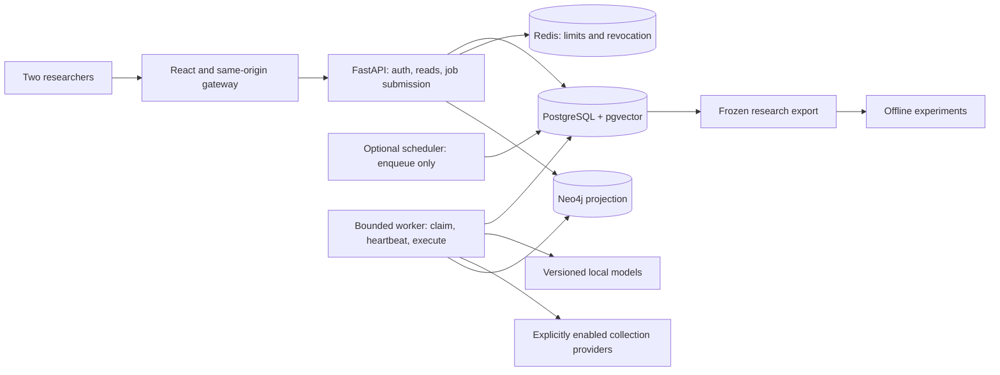

# GMEE production engineering and research delivery plan

Date: 2026-10-14. Status: **proposed; implementation gates are open**.

## 1. Delivery contract

The team has two people, a zero-service-cost preference, two intended users,
and a two-week window. Managed services are preferred when feasible; running
on the owner's PC is acceptable. This plan targets a reliable, reproducible
two-user research pilot with production engineering safeguards. It does not
promise an always-on public production service or publication acceptance in
two weeks.

Only planning documents are introduced by this planning step. Application
code, databases, migration history, credentials, running services and existing
research artifacts are unchanged. Folder trees below describe future work.

Read next:

- [Detailed target structure and contracts](PROJECT_STRUCTURE.md).
- [Executable backlog and acceptance evidence](IMPLEMENTATION_BACKLOG.md).
- [Existing research protocol](RESEARCH.md).
- [Existing operational runbook](OPERATIONS.md), to be reconciled with code.

## 2. Scope and priorities

P0: trustworthy data display, reliable startup, authenticated access, atomic
refresh rotation, bounded and recoverable processing, truthful readiness,
passing quality gates, backup restoration, immutable experiment inputs.

P1: organize touched modules, contract generation, browser journeys,
independent annotation pilot, baseline comparisons, reproducible release.

Deferred: Kubernetes, microservices, multi-region operation, autoscaling,
multi-tenancy, full repository renaming, redesigned graphics, additional
collectors, multilingual claims, new commercial APIs, and new game features.
Keep existing features unless a specific unsupported feature must be disabled
with an explicit UI state. No silent scientific-result substitutes.

## 3. Architecture decision

Use a modular monolith: one Python application package and one React app in
the existing repository. Separate runtime processes without duplicating
business logic or adding a message broker during this sprint.

PostgreSQL is authoritative. Workers poll durable PostgreSQL jobs. Redis is
not the durable job queue. Neo4j is a rebuildable projection whose freshness
is reported. The scheduler only creates jobs; it does not execute ML inside
the API process. Initially run one worker with concurrency one; test competing
workers before permitting additional concurrency.

Queued claim checking shares the worker's loaded models. Returning a job ID
avoids forcing large models into both the API and worker. This is a proposed
API change: introduce an additive job endpoint and migrate the client before
retiring the current synchronous path. Do not silently change v1 response shapes.

## 4. Deployment choices under the budget

| Profile | Placement | Intended use | Gate |
|---|---|---|---|
| Local full stack: baseline | PC hosts web, API, worker, PostgreSQL, Redis, Neo4j and model cache | Full two-user pilot and experiments | Measure available RAM/disk and model peak RSS on day 1 |
| Managed preview: optional | Static frontend on Render; dynamic components only where capacity and persistence are verified | Sharing the UI or explicit read-only snapshot | No fabrication, clearly labeled snapshot age, no claim that it is a live service |
| Managed full stack: later | Containers plus managed durable stores and persistent model artifacts | Public service | Confirm budget, supported vector extensions, private networking, model capacity and recovery |

The local baseline is the fallback allowed by the team, not a commitment to
abandon managed hosting. Do not spend the sprint migrating between free hosts.
Decide whether a full managed deployment is feasible by day 2; otherwise finish
the local pilot and leave the managed profile as a documented follow-up.

Render free web services can spin down after 15 minutes of inactivity and cannot
attach persistent disks. These constraints matter for worker continuity, model
caches and stored results. Sources checked 2026-10-14:
[free service limitations](https://render.com/docs/free),
[persistent disks](https://render.com/docs/disks). No purchased capacity or
availability guarantee is assumed.

A hosted browser cannot reach an API at the owner's localhost. For remote
collaboration, use an authenticated private connection to the local deployment,
or exchange immutable annotation assignments. Do not expose database ports to
the internet. Select and validate a remote-access mechanism before deployment.

## 5. Evidence from the current repository

| Finding | Existing location | Planned response |
|---|---|---|
| Static corpus interception and random graph verdicts | `frontend/src/api/client.ts` | Real requests by default; fixtures restricted to tests or explicit demo adapter |
| Local model not loaded on claim-check cold start | `backend/app/main.py`, `services/verdict/evidence.py`, `services/nlp/embedding_service.py` | Explicit model preparation and worker model lifecycle |
| Durable-job heartbeat has no application caller | `backend/app/services/pipeline/jobs.py` | Periodic heartbeat, fencing and worker recovery |
| Token rotation reads without locking | `backend/app/repositories/session_repository.py` | Atomic rotation with concurrent PostgreSQL test |
| Documented operations routes absent from app wiring | `backend/app/main.py`, `docs/OPERATIONS.md` | Implement the scoped admin API and reconcile documentation |
| Request-context middleware not mounted | `backend/app/core/observability.py` | Wire it and verify sanitized correlation logs |
| Render optional-store settings disagree with required dependencies | `render.yaml`, health and auth dependencies | Explicit deployment capabilities and disabled-feature behavior |
| Alternate startup tolerates failed migration and imports data | `backend/start.sh` | Retire or reconcile entrypoint; no automatic research-data import |
| Multiple historical research/backup entrypoints | `backend/scripts`, `evaluation/scripts` | Inventory, classify and retain compatibility before consolidation |
| Python runtime requirements are broadly unpinned | `backend/pyproject.toml` | Reproducible resolved dependencies and recorded model revisions |

Review evidence, not a new full-suite result: Python syntax passed for 160
files; frontend TypeScript passed; frontend ESLint reported five explicit-any
errors; backend Ruff reported one subprocess-check error. The review located
44 backend and 19 frontend test files. Full suites, live migrations and browser
journeys were not run in that review. Historical HANDOFF.md pass counts are not
current release evidence.

## 6. Two-week schedule

Assumption: 14 calendar days, October 14-27 inclusive in Asia/Calcutta. If this
means ten working days instead, reduce scope at the day-2 checkpoint. Owners
are suggested responsibilities, not assignments to named people.

| Days | Person A: backend and operations | Person B: frontend and research | Exit gate |
|---|---|---|---|
| 1-2 | Reproduce checks; hardware/model inventory; isolated DB fixture; choose deployment profile | Real API transport; map UI contracts; freeze paper question; annotation rubric | Baseline recorded; no random scientific outputs; feasible hardware/profile |
| 3-4 | Model initialization; atomic auth rotation; durable queued-job implementation | Job polling/error states; adapter tests; pilot annotation setup | A submitted bounded job survives client disconnect and produces a traceable result |
| 5-6 | Lease renewal, fencing, retry/recovery; schema upgrade rehearsal | Browser journeys; keyboard/error states; independently label pilot | Restart/concurrency fixtures pass; two-person workflow works |
| 7 | Integrate branches and review failure cases together | Reconcile disagreements and measure annotation time together | Feature and rubric freeze; decide final evaluation scope |
| 8-9 | Backup/restore; logging; dependency/model manifests; fixture release | Finish feasible annotations; frozen event splits; baseline configuration | Restorable snapshot and versioned research dataset |
| 10-11 | Run frozen experiments; record compute and failures | Error analysis and manuscript methods/results draft | Reproducible results or explicit pilot-only report |
| 12 | Reproduce from clean environment using teammate instructions | Verify figures/tables against raw results | Independent reproduction evidence |
| 13-14 | Resolve blockers; release checklist; optional cloud preview | Manuscript consistency, limitations, demo and handoff | Pilot release and research package with honest status |

Annotation work is a substantial shared task, not spare time. After measuring
the pilot, compute remaining pairs from available person-hours divided by
measured annotation minutes, accounting for two independent labels and
adjudication. Do not promise thousands of labels or statistical power in advance.

## 7. Stop and reduce scope rules

- If hardware cannot fit the full ML stack, schedule model stages sequentially
  or use a validated smaller model with a new embedding-space version. Never
  mix old and new vectors just because both have 768 dimensions.
- If the job lifecycle is not correct by day 6, prioritize a bounded worker
  CLI and truthful disabled API states over cloud deployment or broad moves.
- If independent labels or event diversity are inadequate by day 9, deliver a
  pilot study and submission plan. Do not label results publication-ready.
- If optional managed deployment fails capacity/persistence checks, use local
  operation. Do not keep free services awake with artificial traffic.
- If a quality gate fails, fix or explicitly defer the affected feature;
  do not lower thresholds merely to obtain green CI.

## 8. Release evidence and definition of done

All items start unchecked. A proposed design is not an implemented safeguard.

- [ ] Deterministic real-data UI and provenance displayed for scientific results.
- [ ] Auth, role boundaries and concurrent refresh rotation verified.
- [ ] Cold start, missing model, worker restart, expired lease and stale-owner cases verified.
- [ ] PostgreSQL migrations and queue constraints verified on disposable stores.
- [ ] Current lint, type checks, tests and built-image smoke pass with logs.
- [ ] Both researchers complete the core browser journey, including failures.
- [ ] Backup restored to an isolated database and core counts/integrity checked.
- [ ] Model/data/dependency/source manifests and frozen experiment commands recorded.
- [ ] A teammate reproduces results without developer-machine state.
- [ ] Publication claims reflect measured evidence, including negative results.

Proposed pilot performance budget: two simultaneous researchers, read-only API
p95 below 1 second on a declared fixture, and job-submission p95 below 1 second
while one ML job runs. Record request counts, dataset size, duration, hardware,
errors and cold/warm status. These are targets, not observed performance.

Take an encrypted backup before migration and at the end of each annotation
session; keep a second copy off the host. Initial recovery objective: lose no
more than one session and restore within half a working day. A restore drill
must measure whether these objectives are achieved. Local PC uptime is not an SLO.

## 9. Research boundary

The proposed paper focuses on typed claim changes and evidence, with novelty
still to be established. Keep veracity, semantic relation, temporal ordering
and observed transmission as separate concepts. Human annotation, held-out
evaluation and clean-room reproduction remain prerequisites for supported
scientific claims. The two authors may perform blinded annotations, but their
involvement in system design must be disclosed; seek independent adjudication
where available and report disagreement rather than hiding it.

This plan does not replace the existing [research protocol](RESEARCH.md).
Its purpose is to make the software and data path trustworthy enough to run it.
