# Guided daily analysis: parallel implementation plan

Date: 2026-10-17, Asia/Calcutta.
Coordinator: Codex. Frontend implementer: Antigravity.
Baseline: `392d3dfb71c77062b92ea029d94a7bcaf1dddd27` on
`codex/navigation-data-experience`.
Status: planning and interface contract prepared; implementation not started.

## 1. Outcome

An approved developer should understand and complete this workflow without
reconstructing it from technical documentation:

**Check this workspace → gather articles → prepare text → extract claims →
inspect relationships → review results → export → upload → review → publish →
verify the live release.**

The operator must always know which server is connected, what that server can
do, what happened during processing, and what to do next. A page served on
localhost can still be connected to the cloud API. The browser hostname is not
proof that models or a local corpus are available.

This extends the existing local analysis/cloud publication design. Existing
routes, accounts, local datasets and publication-v1 files remain compatible.
The reader navigation redesign is the foundation, not a second redesign target.

## 2. Current implementation and gaps

Already implemented:

- Developer admin/email authorization enforced by the backend.
- Existing-source enable/pause controls and four explicit processing triggers.
- Persistent stage records, bounded cycle sizes and operational counts.
- Completed-result export using a stable database read snapshot.
- Private staging, release review, atomic activation and earlier-release reuse.
- A separate lightweight cloud app without model loading or pipeline execution.

Remaining operator problems:

- Local analysis and cloud publication are easy to confuse.
- A cloud developer-console request can reach local-only API paths.
- Readiness, model preparation and pipeline configuration have no single guide.
- Stage chaining is easy to miss. A completed request can still have skipped work.
- Pending, failed, unknown and completed states need distinct explanations.
- Export dates select **claim extraction timestamps**, not article publication dates.
- Export hints describe present configuration, not verified historical provenance.
- A publication is a complete replacement, so a daily-only export can hide old data.
- Counts and success labels alone do not establish scientific accuracy.

## 3. Scope and research boundary

Deliver a guided operator workflow for the existing pipeline. Start with a small,
controlled collection before any larger run. Preserve user review before
processing, export approval and publication.

This phase does not implement automatic topic-scoped crawling, a truth detector,
an observed misinformation propagation measure, a new annotation platform, an
automatic daily scheduler, durable background workers, cancellation, automatic
cloud synchronization, incremental release merging or arbitrary source creation.
Those need separate designs and evaluation. Topic/event inclusion rules can be
recorded by the researchers manually while this workflow is built.

## 4. Architecture

```mermaid
flowchart LR
    D[Approved developer] --> UI[Shared website / developer workspace]
    UI --> CAP[Existing capabilities API]
    CAP --> LOCAL[Local analysis mode]
    CAP --> CLOUD[Published results mode]
    LOCAL --> CHECK[Developer preflight: read only]
    CHECK --> STAGES[Existing explicitly confirmed processing stages]
    STAGES --> REVIEW[Review actual stored results]
    REVIEW --> EXPORT[Reviewed complete JSON export]
    EXPORT --> FILE[Retained local publication file]
    FILE --> UPLOAD[Cloud upload / private staged release]
    CLOUD --> UPLOAD
    UPLOAD --> APPROVE[Review and explicit publish]
    APPROVE --> ACTIVE[Cloud active release]
    ACTIVE --> READERS[Readers, even with analysis PC off]
```

Use capability responses as the authority. Unknown/offline capability state must
remain unknown/offline. Never silently choose an API or substitute example data.
The browser uploads a downloaded file; no cloud-to-local network tunnel is needed.

## 5. Exclusive ownership

| Owner | Writable paths | Responsibilities |
| --- | --- | --- |
| Antigravity | `frontend/src/features/developer/**` | Guided local workflow and mode-aware entry page |
| Antigravity | `frontend/src/features/publishing/**` | Clear export/upload/review/publication interface |
| Antigravity | `frontend/src/shared/api/developer.ts` | Existing API types plus the frozen preflight contract |
| Antigravity | `frontend/tests/DeveloperConsole.test.tsx`, `frontend/tests/DeveloperUpload.test.tsx`, new `frontend/tests/DailyAnalysisWorkflow.test.tsx`, new `frontend/tests/LocalPublicationExport.test.tsx` | Frontend behavior tests |
| Antigravity | `docs/coordination/ANTIGRAVITY_DAILY_ANALYSIS_STATUS.md` | Its own progress, questions and final handback |
| Codex | `backend/**` | Preflight, export safeguards, authorization and backend verification |
| Codex | `scripts/**`, `infra/**`, root `Start-GMEE.bat` if required | Local launch diagnostics and isolation verification |
| Codex | This plan, `docs/contracts/DAILY_ANALYSIS_API_V1.md`, `docs/coordination/CODEX_DAILY_ANALYSIS_STATUS.md`, handoff prompt, existing operator docs | Contract, coordination and operator instructions |
| Codex during integration only | Other frontend files after ownership release | Necessary routing/runtime integration, without concurrent frontend editing |

All other paths are read-only during parallel work. Neither party changes
authentication, shared navigation, global styling, API URL configuration,
package/lock files, CI, migrations or publication schemas as a routine convenience.
Codex may change an owned backend dependency only with a documented necessity;
the intended implementation needs no new dependency or migration.

If a necessary file falls outside an owner's allowlist, record the exact path,
reason and proposed change in that owner's status file. Stop only the dependent
work and continue other owned tasks. Codex resolves ownership before any edit.
No editing the other implementer's status file or silently expanding ownership.

## 6. Shared checkout rules

The default is the existing shared checkout `D:\expirements\GMEE`. Disjoint path
ownership prevents overlapping edits; it cannot guarantee absence of integration
errors, so tests and a final integration review are still required.

- Only Codex performs Git add/commit/pull/merge/push or branch operations.
- Antigravity must not stash, reset, clean, switch branches, change HEAD or
  overwrite another tool's files. Do not use `git add .`.
- Codex stages only reviewed paths. Antigravity changes are committed only after
  its final handback says the files are released for integration.
- Both may inspect status/diffs and read any non-secret project source.
- Use separate ignored evidence directories: `output/daily-analysis/codex/` and
  `output/daily-analysis/antigravity/`.
- Antigravity runs frontend checks serially. Codex avoids frontend builds/tests
  until the frontend handback; backend checks can run in parallel.
- Do not stop, rebuild or reconfigure shared running services while the other
  party is testing them. Record ports and intended service use first.
- No live account changes, source toggles, collection, upload, publish, database
  restore, data deletion or deployment as part of frontend experimentation.
- Keep `.env`, private account files, tokens and credentials out of reports.

If Antigravity instead uses a different checkout, use the same exact baseline,
commit its owned files on a separate branch, and return commit IDs. Codex then
integrates the commits; never copy entire directories over the shared checkout.

## 7. Work packages

| Package | Owner | Work | Completion evidence |
| --- | --- | --- | --- |
| C0 | Codex | Inspect current code; freeze ownership and API contract | This plan, contract, prompt and two status files |
| C1 | Codex | Add safe developer preflight to the full local app | Authorized read-only response; explicit unknown states; denial tests |
| A1 | Antigravity | Mode-aware developer entry | Local/cloud/offline/unknown states; cloud makes no local pipeline request |
| C2 | Codex | Harden export errors and analysis-window handling | Tests for date selection, active jobs, empty results and replacement limits |
| A2 | Antigravity | Guided local analysis steps | Preflight, existing sources, stages, history, pending/error/skipped explanations |
| C3 | Codex | Verify/repair local startup diagnostics | Full vs preview distinction, safe configuration and model preparation instructions |
| A3 | Antigravity | Guided review, export and cloud publication | Correct date labels, replacement warning, provenance review, deliberate publish |
| A4 | Antigravity | Accessible responsive UI and focused regression tests | Test/check output and browser evidence, or clearly recorded browser blocker |
| C4 | Codex | Integration and actual runtime verification | Combined tests, browser results and explicit untested boundaries |
| C5 | Codex | Review, commit, push; deploy only in an explicit rollout step | Recorded commit, CI and deployment evidence when rollout is requested |

C1/C2/C3 run alongside A1/A2/A3. Antigravity uses API fixtures against the frozen
contract until C1 is ready; fixture success is not proof of a real backend run.
C4 starts only after both implementation handbacks are ready.

## 8. API contract and dependencies

[Daily analysis API v1](../contracts/DAILY_ANALYSIS_API_V1.md) is the shared interface.
Do not rename existing endpoint fields, triggers, capability modes or release
payloads. New preflight is additive and local-only; cloud UI uses existing
capabilities and publication endpoints instead.

If the contract needs to change, Antigravity records `CONTRACT_REQUEST` with a
specific incompatibility in its status file. Codex updates the contract and
announces a new revision before either side relies on it. Optional UI additions
must tolerate their absence. A missing preflight endpoint is an unavailable
check, never an inferred pass.

## 9. Communication and handoffs

There is no assumed direct messaging channel between independent applications.
Shared files are the handoff mechanism; the user can relay a short status request
when either application is idle. Do not claim automatic real-time coordination.

Each implementer updates only its status file after a meaningful milestone,
before changing service use, when blocked, and at final handback. Read the other
status file at task start and before integration. Use a timestamp, package ID,
state, paths, test evidence and the next dependency.

Suggested states: `PLANNED`, `IN_PROGRESS`, `BLOCKED`, `READY_FOR_REVIEW`, `DONE`.
Special messages: `CONTRACT_REQUEST`, `OWNERSHIP_REQUEST`, `SERVICE_REQUEST`.
Never overwrite a handoff request with a generic progress sentence.

Final Antigravity handback must include:

1. Baseline and current HEAD; whether it used this checkout or a separate one.
2. Exact changed/new files and any commits in a separate checkout.
3. Completed packages and behavior changes.
4. Commands run with actual outcomes; fixture vs real-server coverage.
5. Browser/keyboard/mobile evidence, if tested.
6. Open defects and assumptions; no blanket “everything works.”
7. `Frontend ownership released for Codex integration: YES/NO`.

## 10. Acceptance gates

- Approved active admin accounts work; ordinary/inactive/unapproved accounts
  remain denied by the server as well as hidden by the interface.
- Cloud view never offers or attempts local model execution; local-but-disabled,
  disconnected and capability-fetch failures are understandable.
- Preflight exposes no secrets and does not download models or trigger jobs.
- Model metadata availability is not presented as successful inference.
- Existing confirmation steps and bounded cycle limits remain visible.
- Chained work, skip outcomes, active jobs and timeouts are explained accurately.
- Reload does not fabricate completion or automatically retry writes. Re-authenticate
  after reload because session tokens intentionally remain in memory.
- Export dates are extraction dates; provenance is explicitly operator verified.
- Complete replacement and 10 MiB limits appear before export/publication.
- Staging is visibly distinct from publication; stale revision/409 requires review
  refresh. A failed publish leaves the existing complete release visible.
- No horizontal overflow at 390 px; controls work with keyboard; one global shell.
- Meaningful frontend tests, lint, build and architecture checks pass without
  weakening assertions, coverage gates or warning limits.
- Backend targeted tests and applicable cloud/deployment checks pass. Real services
  and real model inference are reported separately from fixtures.

Use disposable local fixtures for write tests. A real collection/model run needs
an agreed bounded dataset and service configuration. Preserve the original corpus
and the current cloud publication throughout verification.

## 11. Sequence and scheduling

1. Now: C0 complete; user gives Antigravity the prompt below.
2. Next implementation session: Codex starts C1/C2/C3 while Antigravity starts A1.
3. First rendezvous: preflight contract tested on the backend; Antigravity switches
   from fixture-only coverage to actual API integration where available.
4. Second rendezvous: both handbacks ready; frontend ownership released.
5. Codex integrates, checks real behavior and reports gaps before any rollout.

Planning allowance: 2–4 focused implementation sessions plus integration, depending
on model downloads, existing local services and test failures. This is not a
promise of paper readiness or a guaranteed calendar completion date.

## 12. Start here

- User: paste [the Antigravity prompt](../prompts/ANTIGRAVITY_DAILY_ANALYSIS_HANDOFF.md).
- Antigravity: claim A1–A4 in its status file and begin owned frontend work.
- Codex: own C1–C5; do not edit frontend concurrently with Antigravity.
- This turn creates coordination artifacts only; no runtime or application behavior
  is changed. The next session can start Codex implementation once Antigravity is launched.
