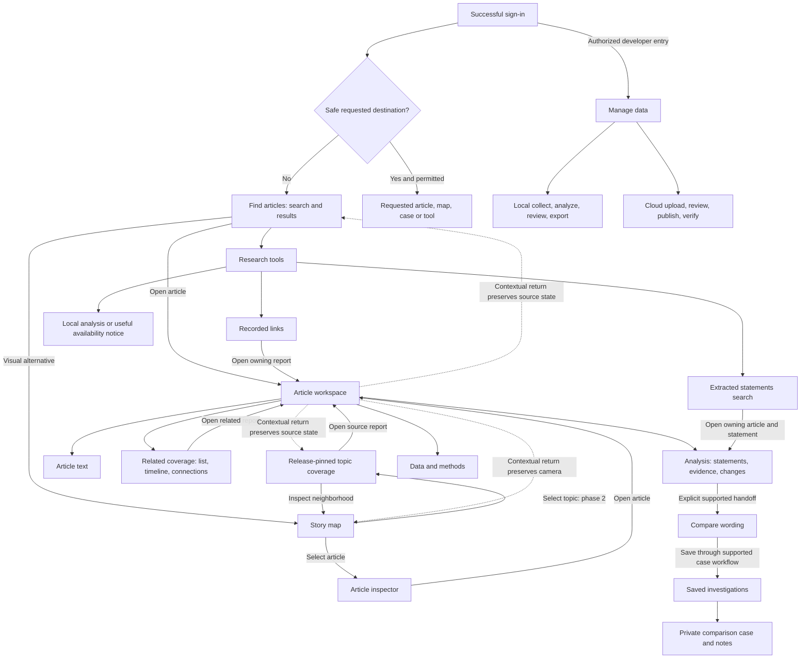

# GMEE: post-login navigation and page experience master plan

**Status:** approved direction; investigation-centered implementation is available for local review. Nothing pushed or deployed in this implementation task.

**Prepared:** 20 October 2026, Asia/Calcutta.

**Scope:** the entire signed-in experience. The public landing page is explicitly excluded and will be designed last.
**Audience:** the two project developers, designers, implementation agents and usability-test participants.

**Implementation record:** [Local implementation and verification, 20 October 2026](../validation/POST_LOGIN_NAVIGATION_LOCAL_REVIEW_2026-10-20.md). The sections below retain the original pre-implementation baseline and proposed rollout gates; they are not a statement that the deployed website already includes the local implementation. Human usability validation, production rollout and the separate landing-page phase remain open.

## 1. Decisions to review first

1. Ordinary sign-in opens **Find articles**, showing search and actual collection records. A separate dashboard of metrics or a compulsory introduction must not stand between the visitor and the data.
2. The four primary destinations are **Find articles**, **Story map**, **Compare wording**, and **Saved investigations**. Their order and wording stay consistent across desktop, mobile and breadcrumbs.
3. **Research tools** is a secondary destination. **Help & methods** and **Account** are consistent utilities. **Manage data** appears separately for authorized developers.
4. One article opens one dedicated article workspace. Its features are organized into five page sections, with contextual subviews rather than nine competing top-level tabs.
5. A topic group and an article are different objects. A proper topic-coverage workspace is a second implementation phase, with release-pinned identity and explicit membership provenance.
6. The existing city graph remains intact. Navigation changes must preserve its geometry, relationships, controls, release pinning and camera restoration.
7. Every existing feature has an assigned home below. Less frequent features remain discoverable; they do not all appear in the first screen.
8. Broad usability is a validation objective. No design can honestly guarantee acceptance by every person. This plan defines observable tasks, accessibility requirements and release gates instead.

These are proposed product decisions, not claims that the paused local navigation draft already meets them.

## 2. What someone sees today, after login

### Baseline and draft distinction

The baseline is the last verified deployed experience represented by `origin/main`, including the graph viewport fixes merged in PR #11. The working directory also contains an unfinished navigation draft on `codex/first-visit-navigation`; it was paused at the user's request. It includes uncommitted landing-page changes. Those changes are **not approved by this plan**, are not a production baseline, and must not be swept into a navigation release. This planning task does not edit, discard, commit or deploy them.

The last verified publication contained 7,421 articles, 5,157 extracted claims and 300 recorded relationships. The city network separately contained 10,442 semantic streets, 23 topic highways and one superway. These are reference figures for planning, never hardcoded UI values or future promises.

### Current visible structure

| Surface | What the baseline shows | First-visit problem |
|---|---|---|
| Ordinary sign-in return | Home at `#/dashboard`, unless a safe internal `next` destination was supplied | An extra orientation page separates login from searching records |
| Desktop navigation | Home; Explore data; Compare wording; My investigations; Advanced tools | Reading tasks, specialist tasks and private work look equally important |
| Explore data children | Articles; Extracted claims; Recorded connections; Collection map | Users must understand the data model and distinguish two graphs before choosing |
| Developer entry | Developer workspace, only when the server permits publication access | Developers also need to see the ordinary reader journey without operational clutter |
| Main Home content | Purpose text, collection counts, article/claim/comparison cards, terminology explanations | Multiple explanations and choices appear before a concrete task |
| Global notice | Published archive date and expandable result explanation | Publication freshness, source dates and analysis dates can be confused |
| Article workspace | Source metadata and nine destinations: Overview, Article, Claims, Related coverage, Evidence, Changes, Timeline, Graph, Data & methods | Many options are visible before the visitor knows what they are trying to answer |
| Two graph destinations | Complete topic/city map and bounded recorded-relationship graph | Different relationship types can look like two versions of the same feature |
| Tools directory | Research features and local infrastructure tools | A cloud visitor can encounter tools that need the analysis PC |
| Mobile | A labeled menu drawer with similar destinations | Any vocabulary/order drift makes users learn the interface twice |

### Current capability boundaries

- Article listing supports text query, source-domain filtering and pagination. The current frontend list contract does not expose arbitrary date sorting, full-body search or a global semantic question-answering interface.
- Article detail, paginated extracted statements and bounded recorded connections exist.
- The complete city map has published topics, coordinates and semantic roads. A dedicated release-pinned topic-detail route/API is not yet an established contract.
- Comparison accepts two supplied passages. Selecting two arbitrary collection articles and automatically transferring their complete text is a separate integration task.
- Saved investigations currently store comparison snapshots, notes and review status. Generic article bookmarks, persistent comparison trays and saved topic alerts are not equivalent to this existing feature.
- The lightweight cloud service serves publications and supported interactions. Local model processing and infrastructure inspection belong to the analysis PC.
- These are source/contract observations, not a fresh claim that every current live workflow has been retested during this planning task.

## 3. Research and the decisions it informs

The following are primary design guidance or official product explanations, reviewed on 20 October 2026. Product comparisons are inspiration, not evidence that their features exist in GMEE or that their outcomes transfer automatically.

| Source | Relevant finding | GMEE application — our design decision |
|---|---|---|
| [NN/G: Menu design](https://www.nngroup.com/articles/menu-design/) | Clear, familiar labels and visible options help people understand available destinations | Put article search and the story map directly in the main navigation; explain specialist destinations in plain language |
| [NN/G: Progressive disclosure](https://www.nngroup.com/articles/progressive-disclosure/) | Advanced or less frequent options can be offered after the core choices | Keep research and operational controls accessible in secondary spaces; reveal article-specific tools in the selected article |
| [Google News Help: finding news and Full Coverage](https://support.google.com/googlenews/answer/9005601?hl=en) | Search and a coverage destination provide complementary entry points into reporting | Support both a search-first route and a visual exploration route into the same attributable articles |
| [Ground News: source sorting and filtering](https://help.ground.news/en/articles/6049857) | Coverage filtering is situated inside a selected story | Place topic-specific publisher/date filters in the coverage workspace when supported; do not copy political-bias or factuality labels without the required evidence |
| [Connected Papers: graph explanation](https://www.connectedpapers.com/about) | A graph should explicitly explain the relationship its edges represent | Keep similarity streets distinct from saved claim relationships and explain each in context; GMEE uses different algorithms |
| [GOV.UK: tabs](https://design-system.service.gov.uk/components/tabs/) | Tabs can hide important content and are poor for comparing information across panels | Keep an overview useful on its own; use actual route links for article sections; show compared passages together |
| [W3C: consistent navigation](https://www.w3.org/WAI/WCAG22/Understanding/consistent-navigation.html) | Repeated navigation retains its relative order | Use one shared navigation definition for desktop, mobile and route labels |
| [W3C: multiple ways](https://www.w3.org/WAI/WCAG22/Understanding/multiple-ways.html) | People benefit from more than one way to locate content | Provide search, map/list exploration and contextual links; do not force graph use |
| [NN/G: tree testing](https://www.nngroup.com/articles/tree-testing/) and [interpreting results](https://www.nngroup.com/articles/interpreting-tree-test-results/) | Navigation labels and hierarchy need testing with intended users | Validate first choices, successful destinations, backtracking and terminology before polishing or broad rollout |

This proposal uses task-oriented organization. It does not impose a rigid three-click rule, copy another company's visual identity, or claim that four menu items is a universal optimum.

## 4. Who sees what

| Person / state | Default experience | Additional visible controls | Restrictions |
|---|---|---|---|
| First-time signed-in reader | Find articles, search, actual records, a short dismissible explanation | Story map, comparison, saved investigations, Help & methods | No developer pipeline/upload controls |
| Returning reader | Same primary navigation; preserve an explicitly requested safe deep link | Their own saved cases and explicit recent-context restoration where implemented | No surprise redirection based on inferred interests |
| Researcher | Same reader experience first | Research tools and any annotation capabilities authorized by the server | A research label alone does not grant publication access |
| Approved developer | Same reader experience first | A separate Manage data entry and local/cloud capability labels | UI mode is a preference, not an authorization mechanism |
| Signed-out / expired session | Sign-in with the safe requested destination preserved | Clear explanation of session expiry | Do not reveal private saved cases or accept privileged actions |
| Keyboard or screen-reader user | Equivalent content and logical navigation | Skip link, visible focus, named landmarks, list alternatives | No task depends exclusively on dragging, hovering, color or graph pixels |

Approved developer identities remain the existing configured allowlist, currently including `pavan@gmee.com` and `prab@gmee.com`. Do not hardcode authorization from those email strings into the frontend. The backend remains authoritative, and the public interface need not display the allowlist.

## 5. The common shell on every signed-in page

### Desktop

```text
┌─────────────────────────────────────────────────────────────────┐
│ GMEE / current section       Search collection   Help   Account   │
├─────────────────┬───────────────────────────────────────────────┤
│ Find articles   │ Contextual Back link / breadcrumb              │
│ Story map       │ Page title + one sentence explaining this page│
│ Compare wording │ Page-specific controls and the actual content │
│ Saved           │                                               │
│ investigations  │                                               │
│                 │                                               │
│ Research tools  │                                               │
│ ─────────────── │                                               │
│ Manage data*    │                                               │
│ Collapse        │                                               │
└─────────────────┴───────────────────────────────────────────────┘
  *Authorized developers only. Collection freshness is compact.
```

- The four main destinations stay visible and in the same order. No nested Explore data menu is required to reach article search or the map.
- The desktop sidebar starts with text labels. A user can collapse it; tooltips and accessible names accompany the icon rail, and the preference persists independently of authentication tokens.
- Global search means **Search collection**. A page-local filter means **Filter these statements**, **Search this topic**, or similarly scoped wording. They must not look interchangeable.
- Every non-root detail page has contextual return navigation. Breadcrumbs describe hierarchy; the Back link restores the actual previous query, selected topic, pagination or camera.
- One primary action is visually strongest in each current task. Source access and interpretation limits remain discoverable without repeating a wall of warnings.
- Keep the current ink/bone/maroon identity. Use the display face for page headings, readable body text for explanations, and monospace for short labels/metadata. Essential navigation copy must not shrink into tiny tracked uppercase text.
- Publication status uses a short line such as “Published collection · updated [date]”. Source publication date and analysis completion appear where relevant, with their distinct labels.
- A graph fullscreen view may hide the global shell, but must offer Exit fullscreen, retain scope/legend and restore the previous shell/camera.

### Mobile and narrow windows

- Keep the section title, a **Menu** button and account access visible. The drawer contains the same labels/order as desktop.
- Show the current page's main action and a contextual return link outside the drawer. Search remains directly usable on Find articles.
- No hover-only submenus. Filters use an explicitly labeled drawer with applied-filter count and a clear reset action.
- Detail section links wrap or become a labeled section selector; there is no mandatory horizontal hunt through nine clipped tabs.
- Compare passages stack into clearly labeled A/B regions; a readable changed-text view remains available.
- Preserve scroll and selection when returning. Opening and closing a drawer restores keyboard focus and does not change the current URL by itself.
- A graph may pan within its own region; ordinary page text and controls must reflow.

## 6. The exact first screen after login

The ordinary destination is **Find articles**, not a new dashboard or a mandatory tour. A deep link to a valid article, map, case or developer workflow still returns to that exact permitted destination.

Above the fold, an ordinary visitor sees:

1. Four main navigation choices with Find articles selected.
2. Page title **Find articles**.
3. A short purpose: “Search collected news reports, inspect their sources, and explore related coverage.”
4. A large, labeled search box: “A name, place, or words from a headline”. Hint: searches saved headlines/authors, not the whole internet.
5. A source filter that matches the existing domain contract. Additional filters appear only when implemented end to end.
6. The actual result count and source article records, with titles, publishers and known dates.
7. A quiet alternative: “Prefer a visual overview? Open the story map.”
8. A short optional “How to use this page” explanation. Dismissal never hides necessary navigation.

Below the first screen: continued results, pagination and relevant collection limitations. Infrastructure health, raw embeddings, run UUIDs and developer queues do not dominate this page.

Initial results must use the API's documented ordering. Do not label them latest, trending, recommended or verified unless the ordering/evidence supports that label.

## 7. Page-by-page visibility and behavior contract

### P01 — Find articles / search results

**Audience:** all signed-in readers. **Existing anchor:** `#/dashboard/browse`.

**Visible:** search query, source filter, applied filters, result count, cards/list rows, pagination and a map entry. Each record shows title, publisher/domain, known publication date and a short stored excerpt only when actually present. Unknown dates stay unknown.

**Primary action:** open the article workspace. The whole title and the Open article action have the same internal destination. Read original source is a separate external action and clearly announces that it leaves GMEE.

**Contextual features:** source filter, clear individual filter, clear all, keyboard result navigation through ordinary links. A future topic badge links to the exact topic group only after P02 exists. Do not invent generated summaries, truth badges or unsupported body-search results.

**Navigation:** search updates query and resets pagination; changing page preserves query/source. Opening an article carries an opaque/safe return context. Back restores filters, offset and scroll position. Switching to the global Story map offers the same keyword only if its meaning is explicit: map title filtering is not equivalent to a semantic search.

**States:** first load; results; no results with specific reset/search suggestions; empty publication; partial failure; offline/unavailable with retry. A failed request must not become a zero-results claim.

### P02 — Topic coverage workspace, phase 2

**Audience:** readers exploring a machine-generated topic neighborhood. **New contract required.**

**Identity:** `(publication run ID, topic ID)`, not a title slug or an allegedly permanent topic ID. An illustrative route is `#/dashboard/topics/:topicId/coverage?release=:runId`; this is proposed, not currently promised to work.

**Visible:** topic label, a clear “machine-generated topic group” descriptor, article count, publisher count derived from membership, known date range, coverage list and the pinned release. Membership is approximate; this page must not claim that all records describe one verified event.

**Sections:** Coverage, Timeline, Connections, Methods. Coverage is the default. Each offers a list alternative and exact relationship scope. A narrative overview appears only if a stored, attributed overview has actually been produced; otherwise the page starts with coverage.

**Primary action:** open an article. **Secondary:** filter publishers, inspect the topic's map neighborhood, choose two available passages for comparison after integration, and save topic context after a persistence contract exists.

**Navigation:** map topic selection opens an inspector first; **Open topic coverage** enters this page. Topic article → article workspace → Back to topic restores the topic filters and release. A historical release remains historical until the user deliberately opens the latest one.

**Dependency gate:** build/validate release-scoped topic detail and paginated membership transport. Direct topic navigation must not require downloading the entire corpus first. Topic search and future date filters need explicit backend contracts. Before delivery, the graph inspector itself remains the available topic view; no dead Topic page link is shown.

### P03 — Article workspace: frame and Overview

**Audience:** all readers. **Existing route:** `#/dashboard/articles/:id/overview`.

**Always visible:** contextual Back link, title, source/domain, author if known, publication date, original-source action, selected section, source-text availability and collection context. Source metadata comes before model output.

**Overview content:** a real stored excerpt, available statements/coverage indicators and a short explanation of what this item contains. Show an obvious next action such as Read stored text, View related coverage or Inspect statements, based on actual availability. Do not pretend that every article has every analysis.

**Five page-section links:** Overview, Article text, Related coverage, Analysis, Data & methods. These are route navigation links with active state, not decorative tab buttons. Each section has a URL and can be opened in a new browser tab.

**Primary action:** Read original source when text is missing, otherwise Read article text. **Contextual actions:** open a related article, select a statement, open this article on the city map, compare available passages when supported.

**Not shown as item metrics:** Redis memory, global service readiness, corpus-wide node counts or unrelated database telemetry.

### P04 — Article text

**Existing route:** article `/article`.

**Visible:** the same article header and section links; stored content with a basis label such as full text, excerpt/snippet or title only, but only where provenance supports that label. Preserve paragraph structure and readable line length.

**Actions:** original source, return to Overview, open related coverage. A select-text-to-compare shortcut is a later feature; do not render a working-looking control before the text-transfer contract exists. Text remains accessible without opening an overlay.

**Missing content:** explain that the collection does not hold the full article and offer the original link. Do not infer completeness from word count or generate replacement prose silently.

### P05 — Related coverage, with List / Timeline / Connections

**Existing routes:** `/related`, `/timeline`, `/graph`, presented as subviews of one Coverage section.

**List:** source titles, domains, timestamps, relationship basis and bounded counts. Distinguish **recorded claim links** from **similar-topic articles**; the latter requires the phase-2 semantic-neighborhood integration. Do not merge them into a count called evidence.

**Timeline:** publication order for the displayed scope, exact/unknown dates and bounded coverage. Earlier publication does not establish the origin of a claim. Provide a readable chronological list before the optional visualization.

**Connections:** the focused recorded relationship graph and an exact link list. The city map is a separate explicit action. State displayed versus total/truncated relationships. A missing graph projection is an unavailable state, not proof that no relationship exists.

**Actions:** open another article; inspect a relationship; change the current subview; return to the originating results/topic. Comparing two articles is a later integration and must disclose title/excerpt-only inputs where applicable.

### P06 — Analysis, with Statements / Evidence / Wording changes

**Existing routes:** `/claims`, `/evidence`, `/changes`.

**Statements:** extracted statement text, owning article, extraction provenance and saved-assessment availability. Select one statement and keep that selection when moving to Evidence. Use a short definition beside the section introduction rather than requiring prior knowledge of “claim”.

**Evidence:** selected statement, stored support/conflict passages and method/provenance when available. A saved heuristic assessment is not a truth probability. Separate previously saved analysis from an explicitly requested new check. Cloud-only readers do not see a working-looking local-model Run action.

**Wording changes:** explicit A/B source context, passages and marked differences; stored candidate evolution links remain distinguishable from user-supplied comparisons. Never replace side-by-side comparison with separate tabs that require memorizing the other passage.

**Empty states:** no statement extracted; choose a statement; evidence not recorded; computation unavailable; permission denied; request failed. These have different messages and recovery actions.

### P07 — Article Data & methods

**Existing route:** `/methods`.

**Visible:** article identity, release when known, input basis, recorded model/version, timestamps, relationship definitions, truncation and missing-data explanations. Plain-language explanation comes first; raw JSON/UUIDs are expandable.

**Actions:** copy an allowed record reference, open the collection's methods help, open an available contextual research tool. Existing advanced-tool links remain accessible, but tools that cannot accept article context must be labeled collection-wide.

### P08 — Story map

**Existing route:** `#/dashboard/atlas`.

**Visible:** complete release/scope, title search, main canvas, differentiated article/topic/theme markers, legend, zoom/fit/fullscreen controls and loading progress. Keep both the global navigation and graph-exploration panel collapsible. A readable article/route list remains available.

**Default:** the existing complete overview with progressive detail. All retained articles remain represented; unsupported inputs remain explicitly separated. No fabricated bridge or road is added for visual completeness.

**Interaction:** select article → inspector → Open article; select topic/theme → inspector → filter neighborhood; select line → supporting-pair explanation. Phase-2 Open topic coverage becomes available only after P02 is implemented.

**Discoverability:** a compact “How to read the map” summary defines size, color and the active edge layer. Exact counts remain in inspectors. Semantic streets, highways/superways and recorded relationship overlays stay distinct.

**Navigation state:** retain immutable release, filters, article/route selection and source-coordinate camera through article drill-down, Back/Forward, collapse/expand and responsive changes. Do not force a fresh full map when returning from one article.

**Preservation gate:** the graph is an existing strength. No navigation redesign may change its data, fake connections, remove zoom/list access or break old pinned links.

### P09 — Compare wording

**Existing route:** `#/dashboard/compare`.

**Visible:** one purpose sentence; Text A and Text B; optional source/time/context; a primary Compare wording action. Use older/newer labels only when that ordering is actually known or supplied. Present results and the two passages together.

**Results:** changes in names/numbers/phrases, available comparison signals, input basis and limitations. Show the supplied source references. Do not present a difference as proof that one report is false or copied.

**Navigation:** this is globally available for people who already have passages. Article/topic entry prefill and comparison-to-saved-case transfer are separately tested integration work. Use identity-bound drafts or bounded memory handoff, not raw article text or private notes in URLs.

**Save:** existing saved-comparison workflow remains usable. Only show a Save investigation shortcut once the receiving case flow can receive the exact intended inputs. Preserve dirty input or warn about losing it before an actual route change; no warning on harmless panel changes.

### P10 — Saved investigations

**Existing route:** `#/dashboard/casebook`.

**Visible:** the signed-in person's saved comparison cases, search, status, last-updated information, notes and existing Markdown/JSON export. The empty state explains that this stores private comparison work and links to the supported creation flow.

**Detail:** title, captured A/B inputs, immutable analysis snapshot, notes, review status, save state and export. “Reviewed” is a workflow status, not a truth label. Archive remains reversible.

**Future:** article bookmarks, topic collections, sharing and team collaboration require their own schema and permission contracts. Do not advertise them as current casebook features. Case details should gain stable safe links if not already routable; never expose another account's case via guessed IDs.

### P11 — Research tools directory

**Existing route:** `#/dashboard/tools`.

**Visible:** a short explanation of who needs this page, task groups and tool availability. Primary reader actions are linked back explicitly; this page is not the default login destination.

**Groups:** inspect statements and recorded links; compare/evaluate analysis; local system tools. Available tools are actionable. Tools requiring the analysis PC remain discoverable in an expandable section with a clear explanation; they do not pretend to run in the cloud.

**Cards:** plain-language name, what it does, input required, resulting output, runtime and permission requirement. Legacy labels are secondary search terms rather than the main wording. The directory must include all preserved features from section 8, including a direct route to global extracted-statement search.

**Navigation:** open a working destination or a useful availability explanation. Back returns to this directory and, when supplied, the originating article. No navigation action automatically starts collection, model inference or publication.

### P12 — Extracted statements search

**Existing route:** `#/dashboard/claims`; existing check routes remain compatibility entries.

**Visible:** page purpose, collection/local scope, query or article selector, owning source article, statement text and recorded assessment where available. A statement opens its article workspace with that statement selected.

**Runtime difference:** cloud mode supports saved-statement search; the current local workflow can be article-scoped. State that difference instead of offering a local global-search input with different behavior. Do not substitute an unrelated corpus node for a selected statement.

### P13 — Recorded links

**Existing route:** `#/dashboard/fullgraph`, reached through Research tools or contextual article/method links.

**Visible:** recorded-only relationship scope, bounded nodes/edges, type/direction semantics and a readable edge list. Explain how this differs from the complete Story map. Offer **Open story map** as an explicit alternative, not an automatic redirect that discards the requested record.

**Actions:** select a node/link, inspect its source records, open the owning article and restore this graph context on return. Large global counts must not be confused with the currently bounded drawing.

### P14 — Help & methods

**Proposed new signed-in help route**, for example `#/dashboard/help`.

**Visible:** a concise site map, “Where do I start?”, explanations of Article / Topic group / Extracted statement / Similarity link / Recorded relationship, data freshness and local/cloud differences. Explain title-only limits, private saved work, session behavior and model-output uncertainty.

**Actions:** links to Find articles, Story map, comparison and the appropriate specialist page. Every important destination has a second discovery route through help/contextual links.

**Phase gate:** until this page exists, a real existing explanation can be linked; do not ship a dead Help entry. A later landing-page design can reference this vocabulary but is outside the present work.

### P15 — Account and session recovery

**Current surface:** account dialog and existing sign-in route.

**Visible:** current identity, existing session actions, sign out and concise session-storage behavior. Do not display credentials/tokens. No credential-reset or new-account permission flows are introduced by this plan.

**Expired session:** preserve a safe internal requested destination. Re-authentication returns there instead of losing the article, topic, case or graph context. The current memory-only session behavior remains until an explicit authentication design decision changes it.

### P16 — Manage data: authorized developer workspace

**Existing anchors:** `#/dashboard/developer`, `#/dashboard/upload`.

**Visible only after server authorization:** a reader/developer context switch, runtime badge, current release and task-based workflow. Ordinary developers can return to the reader interface without losing navigation context.

**Local workflow:** Overview → Sources → Processing → Review → Publishing. Expose gather, preprocess, extraction, relationship analysis and export at their correct stages. Show actual preflight checks, run progress and failed-stage recovery. Do not start a pipeline merely by opening a page.

**Cloud workflow:** Choose file → Validate and stage → Review complete release → Publish reviewed release → Verify live outcome. Show run/digest/counts, replacement scope, current revision and publication history. Uploading is not publishing. A timed-out write requires state reconciliation before any retry.

**Authorization/state:** reader UI never gains privileges from a mode toggle. Research annotation roles and publisher allowlists remain distinct. Publishing retains existing concurrency protection, immutable releases and rollback history.

## 8. No feature is lost: complete destination inventory

| Existing destination / capability | Planned home | Audience and availability |
|---|---|---|
| Home / `#/dashboard` | Compatibility entry to Find articles; brief help remains optional | All signed-in readers |
| Article listing / browse | Main Find articles | Local and cloud |
| Corpus management/listing | Reader listing alias; management in authorized local workspace | Preserve existing permissions |
| Article detail and all nine routes | Five article sections and contextual subviews | Local and cloud |
| Complete article atlas / city graph | Main Story map | Published map or honest unavailable state |
| Full recorded article/claim graph | Research tools → Recorded links | Existing bounded transport |
| Standalone extracted-claim browser | Research tools → Extracted statements | Cloud global search / local article scope |
| FactCheck / check | Contextual Evidence plus standalone statement/check tool | Saved cloud output versus available local computation |
| Mutation comparator | Main Compare wording and contextual changes | Existing backend/runtime capability |
| Private casebook | Main Saved investigations | Current user's authorized cases |
| Project Lab / authored demonstrations | Research tools → Analyzer demonstrations | Authored examples, not a measured benchmark |
| Masala Lab | Research tools → Experimental analysis | Local-only where required |
| Evaluation / annotation | Research tools → Research annotation | Existing research/admin role enforcement |
| System overview / readiness | Local developer/system section | Existing runtime/access restrictions |
| Neo4j inspection / Cypher | Local tools → Graph database inspection | Existing runtime/access restrictions |
| pgvector semantic retrieval | Local tools → Semantic search | Local; do not relabel title matching as this |
| Redis queue/status/memory | Local tools → Queue & system status | Existing runtime/access restrictions |
| 3D global timeline | Research tools → Publication timeline | Local-only if required; article timeline stays readable |
| Sources / processing / review | Manage data, local workflow | Approved developer capabilities |
| Export publication | Manage data → Publishing, local | Approved developers |
| Upload / activate / history / rollback | Manage data, cloud publication workflow | Approved publishers; existing safeguards |
| Account / session controls | Account utility | Own account only |

Directory availability is capability-driven. This table organizes existing access; it does not grant new access to sensitive system controls.

### Specialist-page visibility contracts

These pages inherit the common shell and preserve their current permission checks. They are discoverable from Research tools or the relevant developer workflow, rather than competing with article search at first login.

| Specialist page | Must be visible inside that page | Main action / result | Navigation and availability |
|---|---|---|---|
| Local system overview | Local-workspace label, real collection counts, readiness by service, last check time and failures | Refresh readiness; inspect actual local operating state | Back to tools; local-only in the published cloud experience |
| Neo4j graph inspection | Database scope, supported query/inspection controls, node/edge properties, bounded-result limits and error messages | Execute an explicitly requested permitted query; inspect returned records | Link to source detail when an article identity exists; retain existing server query/access restrictions |
| Semantic retrieval / pgvector | Local semantic-search label, query, returned matches, scores/distance definition and source links | Submit query and open a matching source article | Distinguish from headline matching; unavailable cloud mode gives a useful alternative |
| Redis queue & status | Local runtime scope, queue/connection state, actual memory and latency where reported, freshness | Refresh operational telemetry | No selected-article analytics label; preserve existing access restrictions |
| 3D publication timeline | Scope and known dates, camera/selection controls, readable timeline alternative and meaning of displayed links | Inspect a dated item and open its article | Contextual article timeline remains available separately; keep local-runtime limitations explicit |
| Experimental analysis lab | Experimental label, selected corpus scope, supported parameters, available charts and interpretation limits | Explicitly run an available experiment or inspect saved output | No production-quality accuracy claim; link to source items and return to tools |
| Research annotation | Authorized reviewer identity, assigned pair/item, labeling instructions, source context, progress and explicit save | Record an independent judgment with appropriate provenance | Existing researcher/admin permissions; ordinary readers get an access explanation without annotation data |
| Analyzer demonstrations | Clearly authored example pairs, step explanation, optional supported custom comparison input | Run a demonstration and inspect wording changes | Link to Compare wording; authored examples are not an accuracy benchmark |
| Local corpus management | Source records, actual processing status, supported filters, selection and permitted management actions | Inspect or perform a deliberately selected authorized operation | Reader search remains separate from collection/processing actions; retain current permissions |
| Standalone claim check | Supplied statement, corpus/runtime scope, supported check action or saved-search mode, actual passages and method limits | Explicit new check when supported, or retrieval of previously saved results | Prefer contextual article Evidence for a selected source claim; never auto-run model inference on navigation |

No sensitive query, job start, export, annotation submission or publication is triggered by merely switching to one of these destinations. Keyboard access, useful Back navigation and truthful unavailable states apply to every row.

## 9. Article section mapping: preserve every existing deep link

| Main article section | Contextual subview | Existing URL suffix |
|---|---|---|
| Overview | — | `/overview` |
| Article text | — | `/article` |
| Related coverage | List | `/related` |
| Related coverage | Timeline | `/timeline` |
| Related coverage | Connections | `/graph` |
| Analysis | Statements | `/claims` |
| Analysis | Evidence | `/evidence` |
| Analysis | Wording changes | `/changes` |
| Data & methods | — | `/methods` |

Use semantic navigation links and route active states. A separate tab widget is appropriate only for truly local panel switching and must implement the relevant keyboard interaction. This plan does not require masquerading page navigation as ARIA tabs.

Overview includes a short contents preview linking to every section, so an inexperienced reader can discover available information without guessing. Do not hide essential source metadata behind a tab. Mobile page navigation must expose the selected section and all five choices without a clipped horizontal strip.

## 10. Page-to-page navigation map



The developer edge represents authorized access through its dedicated entry, not an automatic redirect for every administrator. Phase-2 topic nodes and comparison handoffs must not be exposed before their dependencies pass acceptance tests.

### Concrete user journeys

| Goal | Expected path | What must survive |
|---|---|---|
| Find coverage about a place | Find articles → submit → open article | Query, source filter, page, scroll |
| Understand one report | Article Overview → text/source → Analysis when needed | Article identity, statement selection |
| Explore visually | Story map → topic/article selection → article → Back | Release, neighborhood, camera, layers |
| Inspect several sources | Find articles or map → topic coverage → article → Back | Release-scoped membership and topic filters |
| Compare two passages | Compare wording → explicit compare → supported save flow | Exact A/B inputs, sources, context |
| Revisit private notes | Saved investigations → own case → edit → save/export | Case identity, revision, unsaved-state warnings |
| Check a statement's saved context | Research tools → extracted statement → owning article Evidence | Statement ID and return origin |
| Publish daily analysis | Manage data → local export → cloud stage → review → publish → verify | Run/digest/revision and definite write outcome |

## 11. Route and state contract

- Keep the hash router for this rollout. A hosting/router migration is unrelated scope and must not be bundled into navigation work.
- `#/dashboard/browse` remains the canonical search route; `#/dashboard` becomes a compatibility entry. Ordinary sign-in default changes explicitly, while safe `next` handling remains authoritative.
- Preserve `/corpus`, `/check`, `/factcheck`, `/atlas`, `/fullgraph`, `/tools`, `/project`, `/casebook`, `/developer`, `/upload`, all technical routes and all article suffixes through resolution or documented aliases.
- Do not redirect recorded relationships to the semantic map; they have different meanings.
- Persist query, source filter, pagination, article, selected statement, section and map release/camera in bounded validated state. Keep URL semantics consistent across local and cloud modes.
- Raw input passages, credentials, private notes and tokens must not appear in URLs. A comparison/case handoff uses bounded memory or a properly authorized draft resource.
- Invalid IDs, unsupported sections, unknown topic membership and unavailable historical releases produce useful recovery links. No silent fallback to a different article or release.
- New publication availability prompts a deliberate switch for an already pinned research view. The user must not unknowingly compare records from different releases.
- Back/Forward must work with ordinary browser controls, not just the application's Back button.

## 12. Loading, missing data and permission states

Every page spec must implement this state vocabulary:

| State | Required experience |
|---|---|
| Initial loading | Content-shaped placeholder or scoped progress; keep navigation available when safe |
| Free-service startup | Explain connection/wake-up progress without promising a fixed duration; offer retry after a failed request |
| Valid empty result | Explain which search/filter/scope is empty and offer useful changes |
| Missing analysis | Source remains readable; show which saved analysis is absent |
| Unsupported input | Explain coverage limit; preserve the record and original-source access |
| Request error | Keep valid previous content distinguishable from fresh results; allow targeted retry |
| Partial/bounded data | Show displayed and declared total; never label a partial map complete |
| Permission denied | Explain the unavailable action without leaking private data; retain permitted navigation |
| Expired session | Sign in again with safe return context; do not silently submit a pending write |
| Unsaved changes | Warn only before leaving genuinely dirty input; allow the user to stay |
| Ambiguous write outcome | Refresh/reconcile publication or case state before retry; no automatic duplicate write |

Recovery must not send everyone to the landing page. That page is outside this redesign and often loses the user's task context.

## 13. Data integrity and product language

1. Article = attributable report. Topic group = machine grouping within a release. Statement = extracted text. Evidence = attributed supporting/conflicting material when actually available.
2. Semantic similarity, recorded claim relationships and human-reviewed judgments are separate concepts and counts.
3. An article's source date, collection date, analysis date and publication-release date retain distinct labels.
4. No fake-news percentage, factuality ranking, political-bias score, originating-source claim or propagation direction is invented to simplify the UI.
5. A topic group can contain broad subject similarity. Use “related coverage” with an explanation of the basis, not “all reports of the same event” without validation.
6. Unknown data is unknown. Title-only and unsupported-language coverage remain visible at appropriate depth.
7. Keep original text/source references and provenance reachable from every result, map selection and extracted statement.
8. Do not change the published dataset, graph construction or model thresholds in a navigation-only release.
9. Count publishers only when a canonical publisher identity exists. Otherwise label the metric **distinct source domains**, normalize domains consistently and avoid implying independent corroboration or independent ownership.

## 14. Accessibility and visual acceptance

Target WCAG 2.2 AA and verify manually; passing an automated scan alone does not establish conformance.

| Requirement | Plan acceptance |
|---|---|
| [Consistent navigation](https://www.w3.org/WAI/WCAG22/Understanding/consistent-navigation.html) | Repeated destinations keep their relative order and names |
| [Multiple ways](https://www.w3.org/WAI/WCAG22/Understanding/multiple-ways.html) | Search, map/list and contextual/help routes support different discovery preferences |
| [Minimum target size](https://www.w3.org/WAI/WCAG22/Understanding/target-size-minimum.html) | Respect the 24 CSS-pixel criterion and its exceptions; use roughly 44-pixel controls as our stronger project target where practical |
| [Focus not obscured](https://www.w3.org/WAI/WCAG22/Understanding/focus-not-obscured-minimum.html) | Sticky bars, drawers and graph overlays must not completely hide a focused control; aim to keep it fully visible |
| [Reflow](https://www.w3.org/WAI/WCAG22/Understanding/reflow.html) | Ordinary content works at 320 CSS px; contain genuinely two-dimensional maps/tables and provide readable alternatives |
| [Text contrast](https://www.w3.org/WAI/WCAG22/Understanding/contrast-minimum.html) | Check actual colors: 4.5:1 for ordinary text and 3:1 for qualifying large text; validate active/disabled states appropriately |

Also test skip links, heading hierarchy, accessible names, keyboard order, modal focus return, reduced motion, status announcements, browser text zoom and screen-reader access to the graph's list alternative. Do not use color as the only distinction between connection types or states.

Prototype at 390, 768, 1024 and 1440 CSS px, plus the 320-px reflow case and 200%/400% browser zoom as relevant. These are project test cases, not claims that real-device performance has already been measured.

## 15. How we determine whether people understand it

### Before implementation

1. Inventory pages and capabilities against sections 7–8; resolve gaps rather than drawing attractive dead-end controls.
2. Run a short terminology/card-sorting exercise using the actual tasks and labels. Include people who did not build GMEE, including readers less comfortable with research terminology.
3. Tree-test the hierarchy without the polished graph or brand styling. Ask where people would search news, see related coverage, compare text, inspect saved statements and upload a developer release.
4. Prototype desktop and mobile flows, including empty/error cases, and test them with new participants before replacing the working application.

### Proposed pilot

Use an initial moderated sample of 6–8 people spanning novice readers and research users, including mobile and keyboard/assistive-technology perspectives where practical. Test developer operations separately with the two actual developers. Run a second round with fresh participants after revisions.

This is a formative usability pilot, not a representative population study. Report raw counts and observations; a small sample cannot support a claim of 100% universal acceptance. Do not present metrics as unobserved results or as thresholds mandated by NN/G/W3C.

| Task | Success evidence | Proposed release gate |
|---|---|---|
| Explain what the signed-in site does | Participant identifies article discovery, source inspection and comparison without a developer explaining | At least 7/8 in an eight-person pilot, or report/review the actual count if sample differs |
| Find a named article/topic query | Chooses Find articles, searches and opens a source record | At least 7/8 unassisted; median under 60 seconds on warm data |
| Find the visual graph | Chooses Story map without opening specialist tools | At least 7/8 correct first choice |
| Inspect another source and return | Opens related coverage and returns to the same scoped result context | At least 7/8 unassisted; zero lost query/camera defects in automated/browser checks |
| Understand connection meaning | Identifies a link as similarity/recorded relationship rather than proof of falsehood | Investigate every truth/propagation misconception; revise copy and retest |
| Save/revisit comparison work | Uses the supported case workflow and finds only their own work | Successful identity-bound flow; no data-loss or permission defect |
| Publish developer release | Developer distinguishes stage, review and publish, then verifies the exact active revision | Both developers complete rehearsal; zero duplicate/ambiguous-write bypasses |
| Keyboard critical tasks | Performs search, result opening, section navigation and return without a pointer | No critical blocker; all controls reachable and named |

Log first choice, completion, assistance, wrong turns, time and participant words. Separate infrastructure cold-start time from active interaction time. Ask “What would you do next?” rather than teaching the desired label during the test. Change failed labels/placement based on the observed task, then retest with fresh users.

## 16. Implementation work packages, after plan review

| Package | Deliverable | Dependencies / gate |
|---|---|---|
| 0 — Baseline and draft reconciliation | Preserve graph/data behavior; review paused local draft; explicitly exclude landing changes | No blind commit of the current working tree |
| 1 — Information architecture validation | Agreed page inventory, vocabulary, role matrix, route map and tree-test findings | This plan and user review |
| 2 — Shared signed-in shell | Four main links; research/help utilities; developer separation; shared mobile/desktop definition | Existing auth/access contracts preserved |
| 3 — First post-login task | Direct Find articles default; scoped search; actual results and recovery states | Existing list API; no unsupported filters |
| 4 — Article navigation | Five sections, all nine legacy suffixes, Overview contents, preserved statement/back state | Route/section mapping and article integration tests |
| 5 — Contextual integrations | Consistent map/article/recorded-link transitions; comparison/case handoff where supported | Explicit transport and authorization tests |
| 6 — Topic workspace | Release-pinned topic API, paginated membership, Coverage/Timeline/Connections/Methods | New contract and integrity/concurrency tests; separate review |
| 7 — Usability and accessibility validation | Prototype findings addressed; desktop/mobile/keyboard/browser gates pass | No critical task or permission regression |
| 8 — Release | Reviewable PR, CI, staging/rehearsal, exact commit deployment and live verification | Published data unchanged for navigation release; rollback documented |
| 9 — Landing page | Separate later project once the signed-in experience is validated | Explicitly outside current implementation scope |

For a two-person team, packages 1–4 plus initial validation are the first useful release. Topic APIs, generic bookmarks and expanded comparison selection are additional scope, not prerequisites for improving the existing first visit. Estimate effort only after prototype review and API gap resolution; do not promise a complete research platform within an arbitrary number of days.

### Parallel ownership when implementation is authorized

- **Workstream A:** shell, shared navigation, responsive layouts and page presentation.
- **Workstream B:** route/state contracts, capability mapping, topic API design and integration tests.
- Agree shared vocabulary and schemas before parallel edits. Shared files have one owner per change; use separate branches/PRs and a concise coordination record.
- Neither workstream changes graph algorithms, publication contents or the landing page as a side effect.
- This is a proposed division of future work, not authorization to spawn or message another agent now.

## 17. Technical verification and rollout checklist

- [ ] Inventory every existing destination; confirm there is no lost feature or new unsupported promise.
- [ ] Test ordinary sign-in default and safe deep-link return for reader, developer and expired session.
- [ ] Test all existing hashes and article suffixes, including malformed IDs and unknown routes.
- [ ] Verify query/domain/offset/scroll, selected statement, article section and map camera/release restoration through Back/Forward.
- [ ] Verify desktop/mobile labels and ordering come from one definition.
- [ ] Verify special tools, local-only notices, annotation permissions and developer publication restrictions.
- [ ] Verify private cases are isolated by identity; a UI mode toggle never expands access.
- [ ] Verify graph completeness, edge semantics, zoom, inspector and list alternative remain intact.
- [ ] Verify source availability, missing analysis, loading, empty, failed, partial and expired-session states.
- [ ] Verify dirty comparison/case inputs and ambiguous writes recover without silent loss or duplicate submission.
- [ ] Run appropriate route/integration/architecture tests, lint, type check, production build and unchanged coverage gates.
- [ ] Complete usability and accessibility checks with recorded observations, not just developer opinion.
- [ ] Rehearse both local and cloud reader workflows; run developer writes in a safe rehearsal first.
- [ ] Deploy the tested merge commit; verify the actual served asset and every critical live journey.
- [ ] Keep a rollback commit and existing immutable publication history. A navigation rollback should not require republishing data.

## 18. What approval of this plan would mean

Approve or revise the four primary destinations, direct-to-search login, five article sections, secondary research placement and phase-2 topic scope. Then review low-fidelity page wireframes and the navigation prototype before further application work.

Approval does not mean that the paused code draft is accepted, that the landing page is in scope, or that the design is universally understandable. The standard is a clear task model, truthful data presentation, preserved features, measured accessibility and successful first-time journeys.

**Next artifact:** low-fidelity wireframes for Find articles, article Overview/section navigation, Story map entry/inspector, Saved investigations and the developer entry, using this exact visibility and route contract.
