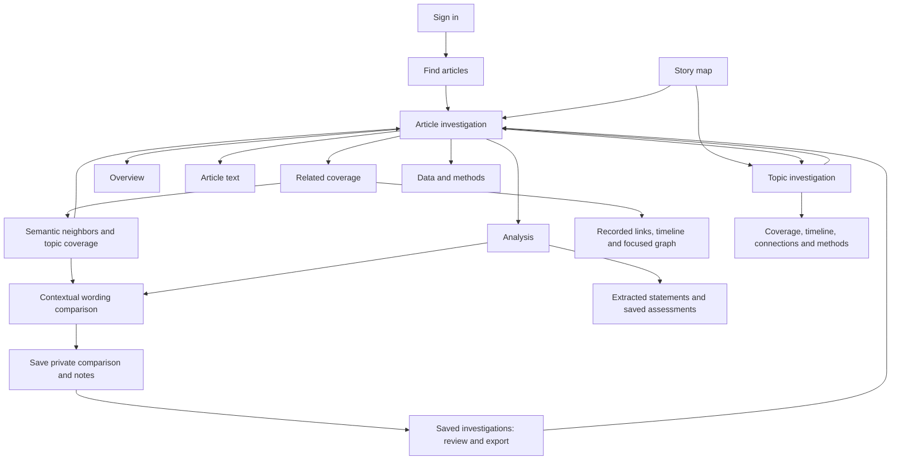

# Post-login investigation navigation: local review

Date: 20 October 2026. Branch: `codex/first-visit-navigation`.

Status: implemented and checked locally. No commit, push, merge, Render deployment, production upload or publication was performed in this task. The public landing page has no content diff.

## Review locally

- Frontend: http://127.0.0.1:3002/#/dashboard/browse
- Isolated rehearsal API: http://127.0.0.1:8004/api/v1
- Use the existing developer account. Credentials are not included in this report.
- Normal page reloads still end the memory-only browser session. Development file changes can trigger that reload; sign in again with the safe return link preserved.

The review API uses the existing local rehearsal SQLite database and an in-memory Redis substitute, bound to loopback. This is a navigation rehearsal, not a production datastore or performance benchmark. Its launcher is in ignored `output/navigation-local-review/serve_preview.py`. Docker was stopped; the real cloud databases and original local analysis corpus were not used for writes.

## Implemented structure

- Four primary destinations shared by desktop and mobile: Find articles, Story map, Compare wording, Saved investigations.
- Ordinary login and the legacy workspace root continue to search. Safe requested deep links remain intact.
- Research tools is secondary and collapsible. Help & methods explains the objects, limitations and next actions. Developer navigation still depends on the server's exact allowlist/role authorization.
- Five main article sections retain all nine existing article route suffixes. Analysis and coverage have contextual subviews rather than a nine-item competing menu. Specialist tool links are confined to Data & methods and the directory.
- Related reporting now exposes topic membership and actual retained semantic neighbors, separately from recorded claim relationships. A missing recorded edge no longer hides available document similarity results.
- A semantic neighbor can open an in-context comparison. Its saved statements can populate a passage when available; missing extraction is explained. Passages remain editable and are never silently inferred to be equivalent claims or chronological versions.
- Comparison drafts survive switching article sections. Explicit saving preserves source context, release/article/claim identifiers, the exact input pair and private review notes in a server-computed case snapshot. Ambiguous save failures do not automatically repeat the write.
- A saved-case deep link foregrounds its selected record and review/export controls. New-case creation is a disclosure. Contextual saves include a safe link back to the article investigation.
- The topic workspace contains paginated coverage, oldest-first publication timeline, published semantic topic highways and methods. Topic labels remain machine-generated; they are not renamed into claimed verified events.
- Release identity, selected statements, claim pagination, source filter/query and safe parent return links are retained. Map return links preserve release, filters, selected node and camera.

## API and data integrity

Added bounded read endpoints:

- `GET /graph/topics/{topic_id}?release=<uuid>&offset=0&limit=20&order=newest`
- `GET /graph/articles/{article_id}/context?release=<uuid>`

Both read materialized published rows. Staged uploads are not accessible by guessing their run identifiers. Topic membership is checked against the published count; semantic neighborhoods are checked against retained degree and endpoint availability. An incomplete projection returns an error instead of zero coverage. Topic articles use deterministic ordering and bounded pagination. Semantic similarity and recorded claim links remain different layers.

The existing article detail, claims and connection reads accept a pinned published release. The full local API also honors an explicit published release rather than substituting mutable local rows. Ordinary local reads retain their original behavior. This prevents topic/map links from mixing historical published assignments with current local analysis. Local and cloud route contracts were updated additively; no publication schema, source array, model output, graph coordinate or retention threshold was changed.

Read-only inspection of the rehearsal dataset confirmed:

| Item | Verified local value |
|---|---:|
| Published run | `315d6109-57bf-4cb1-9395-261825f633da` |
| Rehearsal head revision | 3; independent of the live head |
| Articles | 7,421 |
| Extracted statements | 5,157 |
| Recorded relationships | 300 |
| Semantic streets | 10,442 |
| Topic groups | 98 |
| Unclassified articles | 2,334 |

All 98 topic membership counts match the materialized articles. One local timing observation returned a 20-item topic page in 76.1 ms and a four-neighbor context in 12.0 ms; these observations are not load-test or production latency claims. Machine-readable evidence is in `output/navigation-local-review/data-integrity.json`.

One explicitly labeled private verification case was created in the isolated local rehearsal database. Public publication contents were not edited or republished.

## Verification

| Check | Result |
|---|---|
| Full frontend suite | 327 tests / 45 files passed |
| Coverage gates | Passed unchanged; lines 86.60%, statements 76.74%, branches 73.28%, functions 76.02% |
| Frontend ESLint | Passed |
| TypeScript and production Vite build | Passed |
| Frontend architecture | Passed: 109 source files, no reversed dependencies, direct-fetch bypasses or runtime cycles |
| Targeted backend suite | 61 passed: article investigations, topic/context integrity, maps, publication isolation, city network, cloud isolation and API contracts |
| Backend lint | Passed on changed API and test files |
| Backend strict types | Passed on all three changed API modules |
| Backend dependency/pure comparison checks | Passed |
| Patch whitespace check | Passed |

The production build retains the existing large-bundle warning (main JavaScript approximately 663 kB before gzip). It is not a failing build. No coverage threshold was reduced, and the full backend model/integration suite is not represented by the targeted count above.

Browser checks used the actual rehearsal corpus:

1. Signed in with the existing developer account and searched `modi`: 121 matching records.
2. Opened an article, verified the five primary sections and inspected its real four-neighbor semantic coverage. Missing saved claims remained explicitly missing.
3. Opened its topic: 41 articles / five source domains; checked coverage, publication-order timeline and topic connections.
4. Returned to the originating article and opened a neighbor comparison. Entered attributable supplied headline passages, switched sections, and confirmed the draft remained.
5. Ran an explicit text comparison. The returned category required more context and did not assert truth or observed propagation. Saved a private case and reopened its stored inputs, notes and review/export controls.
6. Loaded the complete map: 7,421 articles / 98 topics / 10,442 semantic streets. Selected a topic and article with the keyboard controls. Opened the topic workspace and verified the return URL retained the selected node, topic and camera view.
7. Tested desktop at 1440 × 1000 and phone at 390 × 844. The phone document width matched its viewport width; no horizontal overflow was observed. Checked the research disclosure, mobile drawer navigation and automatic drawer dismissal.
8. Restored normal browser sizing. Existing keyboard, authentication, developer access and graph-control regressions remain covered by the passing frontend suite. A physical mouse-wheel gesture was not re-tested in this navigation task; its implementation was not changed.

Evidence/screenshots and command logs are under ignored `output/navigation-local-review/`:

- `search-desktop.png`, `article-desktop.png`, `topic-desktop.png`
- `article-final-desktop.png` is the final local review screenshot.
- `coverage-desktop.png`, `saved-case-desktop.png`, `topic-mobile.png`, `search-mobile.png`
- `frontend-coverage.log`, `backend-final.log`, `lint.log`, `build.log`, `architecture.log`, `backend-lint.log`, `backend-types.log`, `backend-architecture.log`

The previous unfinished landing/intro drafts were preserved as `Landing.future-draft.tsx` and `HomeOrientation.future-draft.tsx` in that ignored output directory. They are excluded from the application changes. The three unrelated pre-existing deployment notes were preserved.

## Remaining gates

This implementation is ready for local product review, not a claim of universal usability or scientific validation. The two developers should try finding a story, distinguishing similarity from recorded relationships, comparing passages and returning to the original investigation without guidance. Record any confusion before release. A complete research evaluation, article bookmarks independent of comparisons, and recovery of unsaved work after leaving an entire workspace remain separate scope; comparison drafts currently survive section switches within their mounted article workspace.

After the user reviews localhost: inspect the final diff, commit only the intended files, run the repository release/CI gates, and deploy the additive backend before the frontend so the new read endpoints and pinning semantics are available. Verify the exact served commit, ordinary/developer journeys and graph completeness on Render. Keep the prior navigation commit available for rollback. No data republish is needed for this navigation change. The public landing page remains the last, separate phase.

## Push preparation — 21 October 2026

The user approved pushing the locally reviewed implementation. The branch was fetched against `origin/main` and has no missing main commits. The repository workflow requires a feature branch and a pull request; production deployment remains a separate step after review and CI.

Additional pre-push gates passed:

- Complete backend non-model/non-integration suite: **685 passed, 17 deselected**, coverage **82.47%** against the unchanged 70% gate. Real model and database integration profiles remain CI checks; they were not represented as having run locally.
- Repository-wide backend Ruff passed; strict mypy passed on **223 source files**.
- Frontend architecture regression suite: **3 passed**. The reviewed frontend application suite remains **327 passed** with the lint, build and coverage results recorded above.
- Infrastructure unit suite: **30 passed**.
- Static deployment validator and PowerShell syntax contracts passed.
- Staged diff scope: 43 intended navigation/code/test/contract/document files. The landing-page draft, local output/database/credentials and three unrelated pre-existing deployment notes are excluded.

Additional logs are the `push-*` files in `output/navigation-local-review/`. The PR and GitHub checks provide the authoritative pushed commit and CI status; this local report does not assert a production deployment.
